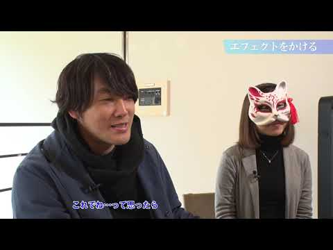

# 🧀 ブログ書きマウス 🧀
# 🧀 写博客的鼠标 🧀

- Published: 2018-12-20T13:41:06+0900
- Original URL: https://lineblog.me/kano/archives/13209928.html
- Wayback snapshot: 20190405104608
- Source HTML: ../data/pages/20190405104608_JNHUJ56EYDYIRJEWDCVKJEETODT6XTHS_lineblog.me_kano_p_3.html

> [!link] 鹿乃「HOPE」Music Video制作 with サイトウユウマ×ASCAN×すこっぷ
> 
>
> [预览图来源](https://www.mouse-jp.co.jp/creator/ss/kano/assets/images/ogp.jpg)
>
> 鹿乃「HOPE」Music Videoラストシーンの制作現場の裏側を公開
>
> [打开原始链接](https://www.mouse-jp.co.jp/creator/ss/kano/) · [查看网页存档](https://web.archive.org/web/20190405104608/https://www.mouse-jp.co.jp/creator/ss/kano/)

12/19 鹿乃newアルバム「rye（ライ）」が発売されました。その中から昨日、TVアニメ「狐狸之声」EDテーマになっている「HOPE」のMVが投稿されました！！

12/19，鹿乃的新专辑《rye（ライ）》发售了！其中，成为TV动画《狐狸之声》片尾曲的《HOPE》的MV，也在昨天投稿上线了！！

しかも、いつもとはまた違った感じ。

而且，这次的风格又跟以往不太一样。

なんと今回はマウス♪マウス♪って乃木坂46さん出演のCMソングでお馴染みの、マウスコンピューターさんが制作協力してくださって、MVだけではなくその制作の裏側もドドン！とまるごと動画でお届けしています🧀

没想到这次是Mouse Computer公司来协助制作——就是乃木坂46出演的那支以“鼠标♪鼠标♪”广告歌广为人知的公司。不光MV，连制作幕后的花絮也“咚！”地一下，全都做成视频送给大家了🧀

<iframe width="480" height="270" src="https://www.youtube.com/embed/QqSDGg_MlTw?feature=oembed" title="嵌入视频" frameborder="0" allow="accelerometer; autoplay; clipboard-write; encrypted-media; gyroscope; picture-in-picture; web-share" allowfullscreen loading="lazy"></iframe>

<video controls preload="metadata" src="../media/db60f7d21cc2.mp4"></video>

> [!video] YouTube
> 
>
> [播放原视频](https://www.youtube.com/watch?v=QqSDGg_MlTw) · [查看网页存档](https://web.archive.org/web/20190405104608/https://www.youtube.com/watch?v=QqSDGg_MlTw)
>
> [封面来源](https://i.ytimg.com/vi/QqSDGg_MlTw/hqdefault.jpg)

<iframe width="480" height="270" src="https://www.youtube.com/embed/w_WA7ycd8kk?feature=oembed" title="嵌入视频" frameborder="0" allow="accelerometer; autoplay; clipboard-write; encrypted-media; gyroscope; picture-in-picture; web-share" allowfullscreen loading="lazy"></iframe>

<video controls preload="metadata" src="../media/b99664b3cdda.mp4"></video>

> [!video] YouTube
> 
>
> [播放原视频](https://www.youtube.com/watch?v=w_WA7ycd8kk) · [查看网页存档](https://web.archive.org/web/20190405104608/https://www.youtube.com/watch?v=w_WA7ycd8kk)
>
> [封面来源](https://i.ytimg.com/vi/w_WA7ycd8kk/hqdefault.jpg)

着ぐるみに、仮面に、背面に………サイトウユウマさんが自分もお面頭にかぶろうかなって言っていたのが個人的にツボにはいって笑っていました。という裏話。

又是布偶装、又是面具、又是背影的………听说サイトウユウマさん说了句“要不我也把面具顶头上好了”，这话特别戳我笑点，我一直笑个不停。这就是那段幕后小花絮。

あとはね〜ご一緒したからとか一切関係なく、鹿乃のポケットマネーでゲットして愛用していたPCブランドさんとのコラボだから純粋に嬉しかったよ🧀

另外呢〜跟“是不是一起合作过”什么的完全无关，纯粹因为是鹿乃自己掏零花钱买下、一直爱用的PC品牌来联动，所以发自内心地高兴🧀

PCゲームしたくてしたくて秋葉原のマウスコンピューターさんのお店に買いに行ってね、営業がはやく終わるほうと営業が遅くまでやっているほうの二軒はしご！！！笑

因为超想玩PC游戏，就跑到秋叶原的Mouse Computer店里去买，把（关门早的那家）和（营业到很晚的那家）两家店都逛了个遍！！！笑

予算あんまりない！タワーの圧迫感ある感じが嫌！このゲームしたい！放送もゆくゆくはしたい！うるさいの嫌！とにかく予算があんまりないけどいい奴をたのry

“预算没多少！讨厌塔式机箱那种压迫感！想玩这个游戏！以后还想着直播！讨厌吵的！总之，预算虽然不多，但还是拜托来台好货（ry”

ていう火の玉ストレートなわがままをすべて聞いて私にあうPCを選んでくれた店員のおじさん、その節は本当にお世話になりました。

那位把我这些像火球直球一样的任性要求全都听进去、帮我挑了一台适合我的PC的店员大叔，那时候真的承蒙您多多照顾了。

自宅で歌録音するのにも問題なく使えるくらい本当に静かでうれしい！ゲームもまったく問題ないどころか快適。

它安静到在家录歌都能毫无压力地使用，太让人开心了！玩游戏也完全没问题，甚至可以说非常舒适。

あと単純にロゴ可愛いよね🧀

而且光看logo就觉得好可爱对吧🧀

というお話でした。

以上就是想跟大家聊的啦。

ぜひみてね〜〜！！

一定要去看看哦〜〜！！

今日はタワーレコード渋谷さん（参加券あり）

今天在涩谷的Tower Records（需要参加券）

はじめてのネットサイン会です。

是第一次的线上签售会。

よろしくねーーーー！

请多关照哦——！

> [!link] rye(初回限定盤)(DVD付)
> 
>
> [预览图来源](https://images-fe.ssl-images-amazon.com/images/I/51XNK5dabIL._SR600%2c315_PIWhiteStrip%2cBottomLeft%2c0%2c35_PIAmznPrime%2cBottomLeft%2c0%2c-5_SCLZZZZZZZ_.jpg)
>
> rye(初回限定盤)(DVD付)
>
> [打开原始链接](https://www.amazon.co.jp/rye-初回限定盤-DVD付-鹿乃/dp/B07J34LYMH/ref=mp_s_a_1_2?__mk_ja_JP=カタカナ&qid=1545278379&sr=8-2&pi=AC_SX236_SY340_QL65&keywords=鹿乃&dpPl=1&dpID=51XNK5dabIL&ref=plSrch) · [查看网页存档](https://web.archive.org/web/20190405104608/https://www.amazon.co.jp/rye-初回限定盤-DVD付-鹿乃/dp/B07J34LYMH/ref=mp_s_a_1_2?__mk_ja_JP=カタカナ&qid=1545278379&sr=8-2&pi=AC_SX236_SY340_QL65&keywords=鹿乃&dpPl=1&dpID=51XNK5dabIL&ref=plSrch)

> [!link] rye(通常盤)
> 
>
> [预览图来源](https://images-fe.ssl-images-amazon.com/images/I/61QEtOF8yrL._SR600%2c315_PIWhiteStrip%2cBottomLeft%2c0%2c35_PIAmznPrime%2cBottomLeft%2c0%2c-5_SCLZZZZZZZ_.jpg)
>
> rye(通常盤)
>
> [打开原始链接](https://www.amazon.co.jp/dp/B07J3H1F9F/ref=asc_df_B07J3H1F9F2552515/?tag=jpgo-22&creative=9303&creativeASIN=B07J3H1F9F&linkCode=df0&hvadid=289075230895&hvpos=1o2&hvnetw=g&hvrand=13552645377461838484&hvpone=&hvptwo=&hvqmt=&hvdev=m&hvdvcmdl=&hvlocint=&hvlocphy=1009312&hvtargid=pla-552260295067&th=1&psc=1) · [查看网页存档](https://web.archive.org/web/20190405104608/https://www.amazon.co.jp/dp/B07J3H1F9F/ref=asc_df_B07J3H1F9F2552515/?tag=jpgo-22&creative=9303&creativeASIN=B07J3H1F9F&linkCode=df0&hvadid=289075230895&hvpos=1o2&hvnetw=g&hvrand=13552645377461838484&hvpone=&hvptwo=&hvqmt=&hvdev=m&hvdvcmdl=&hvlocint=&hvlocphy=1009312&hvtargid=pla-552260295067&th=1&psc=1)
