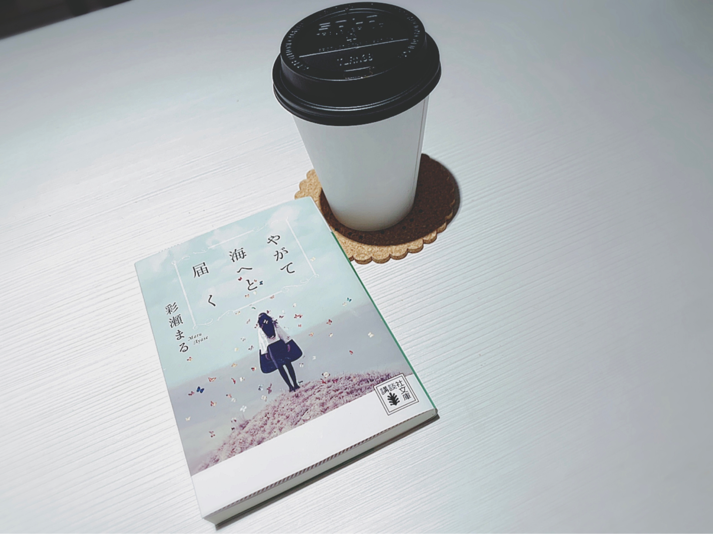

# やがて海へと届く
# 终将抵达大海

- Published: 2019-03-17T12:30:43+0900
- Original URL: https://lineblog.me/kano/archives/13218836.html
- Wayback snapshot: 20190403024415
- Source HTML: ../data/pages/20190403024415_NGG6RM4TWA6E2RFFBZ2UIWEKAAYQEBUX_lineblog.me_kano_p_2.html

[Image source](https://obs.line-scdn.net/0hD60ALoZUGxkNODHy5thkTk9lHXZ0WwERZ0AMI3huETd4VAwZZUIOL3dmWXdHcwUUNDgCLWN4LHV2fyIwdRsNNlZ-F1dSSiw8RT0NYyg8QSomClpHN1pUd3psQy8gDxlOOQxcfn1oQw)

本が好きなひとだった。

是个爱看书的人。

漫画もよく読んでいた。

漫画也读了不少。

ゲームも好きで、アニメも好きで、動物も好きだった。

也喜欢游戏，喜欢动画，也喜欢小动物。

好きなことやものがたくさんあって、それ以上に嫌いなことや苦手なものがたくさんあったひとだった。

喜欢的东西和事有很多，可与之相比，讨厌的、不擅长的东西反而更多——就是这样一个人。

いつか旅立つ「わたし」は、どんなひとなんだろう。

总有一天要启程远行的“我”，会变成什么样的人呢。

知りたいような知りたくないような？？？？

既想知道，又不想知道？？？？

鹿乃
