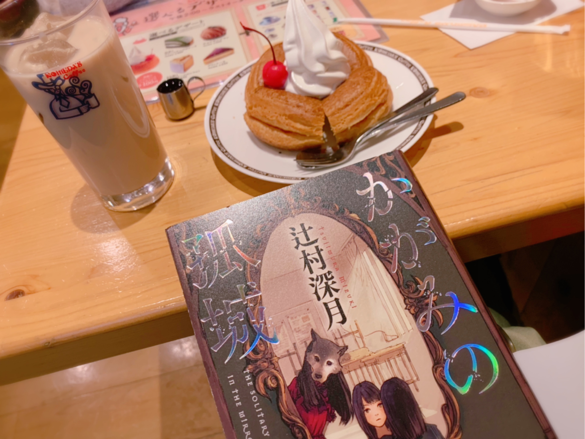

# 午後のティータイム☕︎
# 午后的茶点时光☕

- Published: 2019-03-18T12:10:33+0900
- Original URL: https://lineblog.me/kano/archives/13218910.html
- Wayback snapshot: 20190330220418
- Source HTML: ../data/pages/20190330220418_WWFLEUOYBBTNGGLX2SXOES56L7JHULOW_lineblog.me_kano.html

[Image source](https://obs.line-scdn.net/0hXZQmXI4pB3VsFC2carR4Ii5JARoVdx19BmwQTxlCDVsZeBB1BG4SQxZKRUMTQkNoE3AIZzR2HTIhTQBXLxQPVg5jCy4WXClxLS4tD0kQXUZIJEIiVXVIGxtBWk1EJQUiWCAYEUpAXw)

シロノワールがおいしくて好き。

シロノワール好吃，我很喜欢。

まったく知らない外国の音楽に混じって聴こえてくる話し声とか、食器のカチャカチャした音とか、紙のこすれる音。

完全没听过的外国音乐里，混着传来的说话声啦、餐具叮叮当当的碰撞声啦、还有纸张摩擦的声响。

カフェにいると色々きこえてくる。

待在咖啡馆里，总能听到各种各样的声音。

静かじゃないのに気にならないし落ち着くのは、自分にまったく関係ないからなのかな？

明明并不安静，却不会让人在意，反而觉得安心——是因为这些都和自己完全无关吗？

関係ないから、責任なんてなにもないし、近すぎない人の気配のおかげで孤独感もないからなのかな？

因为无关，所以没有任何责任要承担；也因为能感觉到不远处人的气息，不会有孤独感——是这样吗？

作品作りで自分の内面を形に〜って話しがあって、ふとした瞬間に自分が感じたことをノートやブログに書きとめとこうってしてるんだけど、なかなかにこれが難しい。

曾听人说过“做作品就是把自己的内心具象成形～”这样的话，所以我试着把某个瞬间自己感受到的东西记进笔记本和博客里，但这件事真的挺难。

振り返ってみると、自分の長所短所を〜〜みたいなやつ書くの苦手だったなあ。

回头想想，写“自己的优点缺点～”这类东西，我一直都很不擅长啊。

別に病んでるわけじゃないよ！笑笑

可不是我心态崩了哦！哈哈

SNSって声色とか仕草とか、言葉の表情をみせることができないから難しいな〜って何年経っても思う。

无论过多少年我都觉得，SNS没法传达语气声调、动作神态这些“话里的表情”，真的好难啊〜

SNS得意勢が羨ましいぜ

真羡慕擅长玩SNS的人啊

ちなみにこれは昨日書いていて、今日のわたしは今頃ライブリハ。ひゃはあ頑張ってるぜ。

顺带一提，这些是昨天写的，今天的我这时候正在Live彩排。嗨呀，我可努力着呢。

鹿乃
