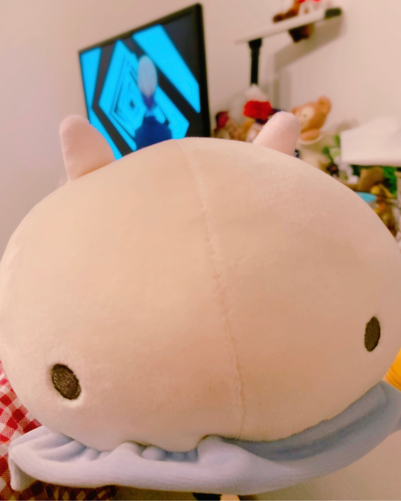

# 🌊🐄

- Published: 2019-03-20T21:52:12+0900
- Original URL: https://lineblog.me/kano/archives/13219272.html
- Wayback snapshot: 20190330204557
- Source HTML: ../data/pages/20190330204557_D46MWYIRNED6BKYIWVA67X4W326D33K7_lineblog.me_kano_archives_13219272.html.html

[Image source](https://obs.line-scdn.net/0hS8cDGwlaDBdePSbiYP9zQBxgCngnXhYfNEUbLStrBjkrURsXNkcZISRjTlw0UQ8HJz0oJxN6InUJeh8oOScEc391NnEKCkoxK1kqbXs5ViVyBE9DYFlDeSlvUSF2Cw5AagkXdSs0Vg)

前から思ってたんです。

我一直就挺在意这件事的。

トランプの定番ゲーム「神経衰弱」

扑克牌的经典游戏《神经衰弱》

名前めっっっっちゃ怖くないです？？？？

这名字是不是超超超超吓人？？？？

写真はウミウシのぬいぐるみ。週末の中国ライブに向けての買い物をしに行ったのにね、気付いたらウミウシのぬいぐるみ買ってたの。

照片里是海蛞蝓的玩偶。明明是为了周末的中国演出去买东西的，结果一回过神来，已经买下了海蛞蝓的玩偶。

準備したのは移動中にするつもりのswitchのみ。や、やばい………

准备了的只有打算在途中玩的switch。糟、糟糕了………

鹿乃
