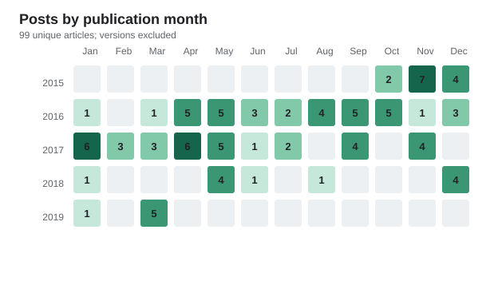

# Kano LINE Blog Recovery

[简体中文](README.md) | [日本語](README.ja.md) | [English](README.en.md)

鹿乃（Kano）の LINE Blog を保存したオフラインアーカイブです。日本語の原文、簡体字中国語版、および記事で使用されたメディアを収録しています。

## 内容

- `BLOG/`：日本語の原文。日付付きの記事が 100 件あります。
- `BLOG_zh-cn/`：簡体字中国語版。日付付きの記事が 100 件あります。
- `media/`：両方のブログで共有するメディアフォルダー。314 ファイル（JPG 265、PNG 24、MP4 25）を収録しています。
- `archive/`：補助メタデータ、復元レポート、統計ファイル、元の ZIP バックアップ。`.gitignore` に追加しており、ローカルのアーカイブとして保持します。
- `archive/article-id-map.json`：LINE Blog の記事 URL と記事 ID の対応表。
- `archive/media-name-map.json`：復元前のメディア名とローカルファイル名の対応表。
- `archive/version-diff-report.md` / `archive/version-diff-report.json`：保存された記事バージョンの差分レポート。
- `archive/posting-activity-by-month.csv` / `posting-activity-heatmap.svg`：投稿活動の集計データ。

記事内のメディアリンクは `../media/...` に統一しています。そのため、2 つのブログディレクトリから同じメディアを参照できます。

## 投稿数のヒートマップ

記事の公開月で集計し、複数バージョンは 1 件として数えています。重複を除いた記事数は 99 件で、2015 年 11 月が最多の 7 件です。



## 内容タイプ別の集計

`BLOG/` の日本語原文を基準に、タイトルと本文から主な内容を分類しています。複数のテーマを含む記事は、主なテーマの 1 タイプだけに集計しています。

| 内容タイプ | 件数 | 説明 |
| --- | ---: | --- |
| 日常生活・趣味 | 38 | 日常、旅行、食事、趣味、随筆 |
| ライブ・イベント | 22 | ライブ、チケット、イベント、即売会、グッズ |
| 音楽・作品制作 | 21 | シングル、アルバム、MV、録音、創作 |
| ファン交流・Q&A | 10 | 挨拶、質問、回答、交流 |
| アニメ・映像・コラボ | 8 | アニメ、映像作品、コラボレーションの告知 |
| **合計** | **99** | 重複を除いた記事数 |

## 大容量動画の分割アーカイブ

`5deac0f60979.mp4` と `ecc3e9bbd6b0.mp4` は GitHub の 1 ファイル 100 MB 制限を超えています。記事内の `../media/...` リンクを変更しないため、リポジトリには `media-parts/` の gzip 分割ファイルを保存しています。復元した動画は元の `media/` パスに置いてください。

Windows では、リポジトリのルートで次を実行します。

```powershell
cmd /c copy /b "media-parts\5deac0f60979.mp4.tar.gz.part-*" "media-parts\5deac0f60979.mp4.tar.gz"
tar -xzf "media-parts\5deac0f60979.mp4.tar.gz" -C media
cmd /c copy /b "media-parts\ecc3e9bbd6b0.mp4.tar.gz.part-*" "media-parts\ecc3e9bbd6b0.mp4.tar.gz"
tar -xzf "media-parts\ecc3e9bbd6b0.mp4.tar.gz" -C media
```

Unix 系では `cat media-parts/<name>.part-* > <name>.tar.gz` で結合してから、同じ `tar -xzf ... -C media` を実行してください。結合後の `.tar.gz` は一時ファイルで、`.gitignore` により無視されます。

## 閲覧方法

Markdown 対応のビューアーで記事を直接開いてください。

## 出典

元のブログ：<https://lineblog.me/kano/>

## 謝辞

過去のページとメディアの復元に必要なウェブアーカイブを提供してくださった [Internet Archive Wayback Machine](https://web.archive.org/) に感謝します。

記事、画像、動画などの著作権は原作者および各権利者に帰属します。このプロジェクトはローカルのオフラインアーカイブを整理するものです。
